<h1 align="center">Hey, I'm Chirag Anand 👋</h1>

  <strong>Go &amp; Python developer · Open-source contributor</strong> 
  Building with Go and Python, and exploring developer tools.

  
  

---

### About me

- 🛠️ I enjoy building useful tools and applications
- 💻 Interested in Go, Python, developer tools, and open source
- 🌱 Always learning by building and contributing

### Tech I work with

**Focus areas**  
CLI tools · Developer tools · Open source

### Featured projects

| Project | Description |
| --- | --- |
| [**gocli**](https://github.com/chirag-433/gocli) | Monitor website and API health with concurrent checks, TLS certificate tracking, and persistent endpoint storage. |
| [**repo-stats-cli**](https://github.com/chirag-433/repo-stats-cli) | Explore GitHub repository metrics in a formatted terminal table with this Python CLI. |

### GitHub at a glance

  
  

  

---

  <i>Building, learning, and contributing — one commit at a time.</i>

