# Hey, I'm Chirag Anand 👋

CSE student building things with **Go and Python**. Interested in backend engineering, developer tools, and open source.

 

### Tech

**Languages** · Go · Python · Java · JavaScript  
**Focus** · Backend development · REST APIs · CLI tools · Open source

### Featured projects

| Project | What it does |
|---|---|
| [gocli](https://github.com/chirag-433/gocli) | Go-based website and API health monitor with concurrent checks, TLS certificate tracking, and persistent endpoint storage |
| [repo-stats-cli](https://github.com/chirag-433/repo-stats-cli) | Python CLI for viewing GitHub repository metrics in a formatted terminal table |

### GitHub stats

  
  

### Contribution activity

  

---

  <i>Building, learning, and contributing — one commit at a time.</i>

